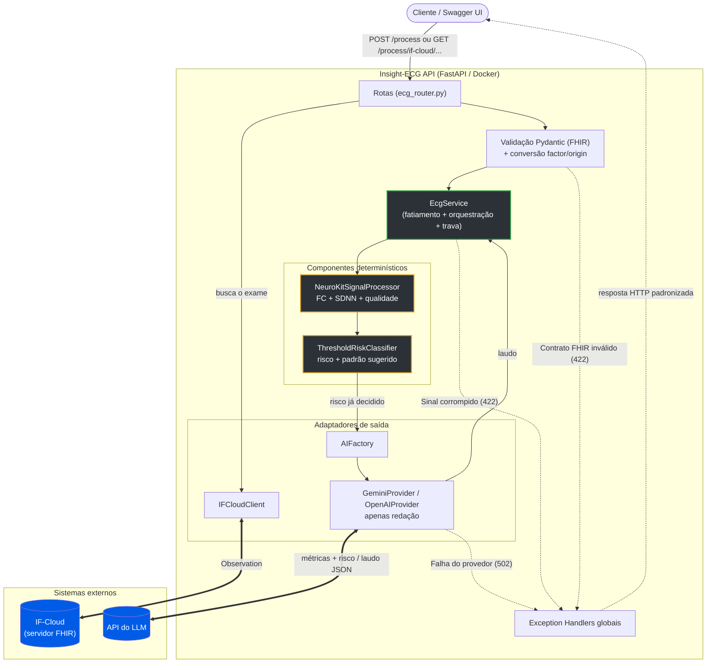

# POC: Insight-ECG API

[](https://www.python.org/)
[](https://fastapi.tiangolo.com/)
[](https://www.docker.com/)
[](https://github.com/LeonardoEnnes/poc-insight-ecg-api/actions/workflows/ci.yml)

> [!IMPORTANT]
> POC finalizada. Código correspondente ao TCC *Insight-ECG: Síntese de Laudos Clínicos para Ecossistemas Interoperáveis utilizando Processamento de Linguagem Natural* (IFSul — Tecnologia em Sistemas para Internet).

## Sumário
- [Visão Geral](#visão-geral)
- [Fluxo do Sistema](#fluxo-do-sistema)
- [Arquitetura e Tecnologias](#arquitetura-e-tecnologias)
- [Como Executar Localmente](#como-executar-localmente)
- [Como rodar os Testes](#como-rodar-os-testes)
- [Rotas disponíveis](#rotas-disponíveis)
- [Validação do Classificador de Risco](#validação-do-classificador-de-risco)
- [Estrutura de pastas](#estrutura-de-pastas)
- [Arquitetura do Sistema](#arquitetura-do-sistema)
- [Documentação Aprofundada](#documentação-aprofundada)

## Visão Geral

O **Insight-ECG** é um *middleware* de apoio à decisão clínica integrado ao ecossistema **IF4Health**. Ele recebe exames de ECG no padrão HL7 FHIR, extrai métricas de ritmo, classifica o nível de risco e gera um laudo textual preliminar.

O sistema combina processamento determinístico de sinal (DSP) e classificação de risco baseada em regras com um LLM, que atua exclusivamente como **redator**: comunica em linguagem clínica um resultado já calculado e decidido por código, sem decidir a interpretação do sinal nem o nível de risco.

> [!NOTE]
> O sistema é uma ferramenta de apoio à priorização de exames. Ele analisa uma única derivação e apenas o ritmo (frequência cardíaca e variabilidade RR), não emite diagnóstico e não foi validado clinicamente.

## Fluxo do Sistema

1. **Entrada**: o sistema recebe um recurso FHIR `Observation` no corpo da requisição ou o identificador de um exame armazenado no IF-Cloud.
2. **Integração**: nas rotas de integração, o `IFCloudClient` busca o exame no IF-Cloud usando o token do usuário.
3. **Validação e conversão**: o Pydantic valida o contrato FHIR, e cada valor do sinal é convertido por `valor × factor + origin`; a taxa de amostragem é calculada como `1000 / period`.
4. **Fatiamento clínico**: exames com mais de 30.000 pontos têm apenas o trecho inicial analisado (cerca de 83 s a 360 Hz, 1 min a 500 Hz), e a análise é marcada como `PARCIAL`.
5. **Extração de métricas (DSP)**: o `NeuroKitSignalProcessor` calcula a frequência cardíaca média e o SDNN, e verifica a qualidade da detecção (sinais sem batimentos reais são marcados como `INSUFICIENTE`).
6. **Classificação de risco**: o `ThresholdRiskClassifier` decide o risco (`BAIXO`, `MEDIO`, `ALTO` ou `INDETERMINADO`) e gera um **padrão sugerido** com as ressalvas de incerteza.
7. **Redação do laudo**: as métricas, o risco e o padrão sugerido são enviados ao LLM (Gemini ou OpenAI) com *guardrails* no *prompt*.
8. **Trava determinística**: o `EcgService` sobrescreve os campos `risco` e `padrao_sugerido` com os valores do classificador e devolve o laudo em JSON, com o tempo de processamento.

## Arquitetura e Tecnologias

* **Framework:** [FastAPI](https://fastapi.tiangolo.com/)
* **Validação de Dados:** [Pydantic](https://docs.pydantic.dev/) (contrato FHIR na entrada e *schema* do laudo na saída)
* **Processamento de Sinal:** [NeuroKit2](https://neuropsychology.github.io/NeuroKit/) 0.2.10
* **Provedores de LLM:** [Google Gen AI SDK](https://pypi.org/project/google-genai/) (Gemini, padrão) e [OpenAI SDK](https://pypi.org/project/openai/) (`gpt-4o-mini`), selecionados pela variável `AI_PROVIDER`
* **Testes:** pytest e [DeepEval](https://github.com/confident-ai/deepeval) (qualidade textual via LLM-as-a-judge)
* **Infraestrutura:** Docker e Docker Compose

> [!WARNING]
> Nomes de modelo de LLM mudam com frequência e podem ser descontinuados sem aviso. Se a API retornar erro 404 mencionando "no longer available", confira `AI_MODEL_NAME` no `.env` e o `model_name` em `tests/quality/gemini_judge_model.py`.

## Como Executar Localmente

### Pré-requisitos
* [Docker Desktop](https://www.docker.com/products/docker-desktop/) instalado e em execução.
* Integração com WSL 2 ativada (se estiver no Windows).

### Subindo o Ambiente

1. Clone o repositório:
   ```bash
   git clone https://github.com/LeonardoEnnes/poc-insight-ecg-api.git
   cd poc-insight-ecg-api
   ```

2. Configure as variáveis de ambiente:
   ```bash
   cp .env.example .env
   ```
   Edite o `.env` com a sua chave:
   ```bash
   AI_PROVIDER=gemini
   AI_API_KEY=COLE_SUA_CHAVE_AQUI
   # Confira o nome atual do modelo na documentação do provedor
   AI_MODEL_NAME=gemini-3.8-flash
   ```
   A chave do Gemini é gerada no [Google AI Studio](https://aistudio.google.com/app/api-keys). Para usar a OpenAI, defina `AI_PROVIDER=openai`, `OPENAI_API_KEY` e `OPENAI_MODEL_NAME`.

3. Suba a aplicação:
   ```bash
   docker compose up --build
   ```

4. Acesse:
   - Health Check: http://localhost:8000/health
   - Swagger UI: http://localhost:8000/docs

## Como rodar os Testes

Suíte principal (29 testes, usa provedores de IA simulados, sem custo):
```bash
docker exec -it poc-api pytest -v --ignore=tests/quality
```

Com cobertura:
```bash
docker exec -it poc-api pytest --cov=app --cov-report=html --ignore=tests/quality
```

> [!IMPORTANT]
> Os testes em `tests/quality/` (DeepEval, 8 testes) fazem chamadas **reais** à API do Gemini e consomem a cota gratuita, que é de poucas requisições por dia. Por isso, eles não rodam na CI e devem ser executados isoladamente:
> ```bash
> docker exec -it poc-api pytest tests/quality/ -v -s
> ```

## Rotas disponíveis

Todas as rotas ficam sob o prefixo `/api/v1/ecg`.

| Método | Rota | Parâmetros | Uso |
|---|---|---|---|
| POST | `/process` | Recurso FHIR no corpo | Exame enviado diretamente |
| GET | `/process/if-cloud/{observation_id}` | `minute` | Analisar um minuto específico do exame no IF-Cloud |
| GET | `/process/if-cloud/{observation_id}/range` | `start`, `end` | Analisar um intervalo de pontos |
| GET | `/process/if-cloud/{observation_id}/full` | — | Analisar o exame inteiro, sujeito ao fatiamento clínico |

As rotas do IF-Cloud exigem o token de acesso do usuário no cabeçalho `Authorization: Bearer`. Consulte o [guia de integração com o IF-Cloud](docs/INTEGRACAO_IFCLOUD.md).

## Validação do Classificador de Risco

A pasta `validacao/` reúne os scripts que avaliam o processamento de sinal e o classificador **sem chamar o LLM** (gratuitos e reprodutíveis):

| Script | O que faz |
|---|---|
| `validar_em_lote.py` | Avalia os 52 exames do IF4Health (`tests/fixtures/ecgs_raw`) |
| `validar_ptbxl.py` | Avalia exames da base pública [PTB-XL](https://physionet.org/content/ptb-xl/) (derivação II, 500 Hz) |
| `calibrar_ptbxl.py` | Escolhe o limiar de SDNN nos subconjuntos 1 a 8 da PTB-XL pelo maior F1 macro |

```bash
docker exec -it poc-api python validacao/validar_em_lote.py tests/fixtures/ecgs_raw
docker exec -it poc-api python validacao/validar_ptbxl.py --n 25 --folds 9
docker exec -it poc-api python validacao/calibrar_ptbxl.py
```

Os relatórios de cada etapa ficam em `validacao/resultados/`. Resumo dos resultados com o limiar final de SDNN (55 ms):

| Conjunto | Acurácia | F1 macro |
|---|---|---|
| PTB-XL, subconjunto 9 (teste final, nunca usado no desenvolvimento) | 76,2% | 0,699 |
| PTB-XL, subconjunto 10 | 72,5% | 0,643 |
| IF4Health (52 exames) | 86,5% | 0,860 |

> [!NOTE]
> O risco esperado de cada padrão (BAIXO para ritmo normal, MEDIO para extrassístole e fibrilação atrial, ALTO para *flutter*) é uma decisão técnica do projeto, não uma classificação clínica validada. Detalhes em [`docs/DECISOES_TCC_II.md`](docs/DECISOES_TCC_II.md).

## Estrutura de pastas

O projeto segue a **Arquitetura Hexagonal (Ports & Adapters)**: o núcleo depende apenas de interfaces (portas), implementadas por adaptadores substituíveis.

```text
├── app/
│   ├── core/                     # Configurações, exceções, portas e prompts
│   │   ├── config.py
│   │   ├── exceptions.py
│   │   ├── exceptions_handler.py
│   │   ├── prompts.py
│   │   ├── risk_classifier.py    # Porta: classificador de risco
│   │   └── signal_processor.py   # Porta: processador de sinal
│   ├── infrastructure/           # Adaptadores
│   │   ├── classification/
│   │   │   └── threshold_risk_classifier.py
│   │   ├── ia/
│   │   │   ├── base.py           # Porta: LLMProvider
│   │   │   ├── factory.py        # AIFactory
│   │   │   ├── gemini.py         # GeminiProvider
│   │   │   └── openai_provider.py
│   │   ├── signal/
│   │   │   └── neurokit_processor.py
│   │   └── if_cloud_client.py
│   ├── routes/                   # Rotas HTTP (FastAPI)
│   ├── schemas/                  # Contrato FHIR (Pydantic)
│   ├── services/                 # EcgService (orquestração)
│   └── main.py
├── tests/
│   ├── fixtures/                 # Sinais e payloads FHIR por padrão (normal/apb/afl/afib)
│   ├── infrastructure/           # DSP, testes adversariais e cliente IF-Cloud
│   ├── quality/                  # DeepEval (chamadas reais, fora da CI)
│   ├── router/                   # Rotas HTTP
│   └── service/                  # EcgService
├── validacao/                    # Scripts de validação do classificador e resultados
├── docs/                         # Decisões técnicas e guias
├── .env.example
├── docker-compose.yml
├── Dockerfile
├── pytest.ini
└── requirements.txt
```

## Arquitetura do Sistema



## Documentação Aprofundada

- [Decisões do TCC I](docs/DECISOES_TCC_I.md): arquitetura hexagonal, padrões de projeto e decisões da primeira etapa
- [Decisões do TCC II](docs/DECISOES_TCC_II.md): DSP, classificador de risco, validação externa e achados
- [Integração com o IF-Cloud](docs/INTEGRACAO_IFCLOUD.md): autenticação e uso das rotas de integração
- [Troubleshooting](docs/TROUBLESHOOTING.md): erros comuns e soluções
